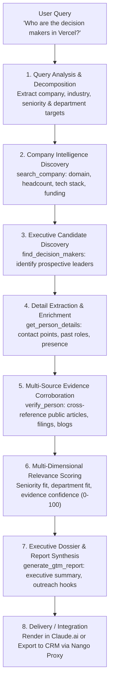

# Outmate GTM — Data Flow Specification

## 1. End-to-End Query-to-Report Workflow

This document details the lifecycle of a user research query through the Outmate GTM engine.

---

## 2. Granular Stage Specifications

### Stage 1: Query Analysis & Decomposition
- **Input**: Raw natural language string (e.g. *"Who are the decision makers in the company Vercel?"*).
- **Processing**: The planner evaluates target entity candidates, target seniority levels (`c_level`, `vp`, `head`), and departmental scope.
- **Output**: Validated `ResearchPlan`.

### Stage 2: Target Company Intelligence Discovery
- **Tool**: `search_company(company_name, domain)`
- **Service**: `CompanyResearchService.research_company`
- **Actions**:
  - Resolves canonical corporate domain (`vercel.com`).
  - Scrapes metadata, public registry entries, and press records.
  - Normalizes industry category, headquarters, estimated headcount, and tech stack components.
- **Output**: Validated `CompanyProfile` containing evidence citations.

### Stage 3: Executive Candidate Discovery
- **Tool**: `find_decision_makers(company_name, company_domain, target_seniority, target_departments, limit)`
- **Service**: `PeopleResearchService.find_decision_makers`
- **Actions**:
  - Executes targeted public queries isolating company executive pages, team directories, and news announcements.
  - Normalizes candidate titles into standardized `SeniorityLevel` tiers and `Department` functions.
- **Output**: List of candidate `DecisionMaker` records with `VerificationStatus.UNVERIFIED`.

### Stage 4: Detail Extraction & Enrichment
- **Tool**: `get_person_details(full_name, company_name, linkedin_url)`
- **Service**: `PeopleResearchService.get_person_details`
- **Actions**:
  - Identifies public professional handles (LinkedIn URL, Twitter handle, GitHub username, corporate email format).
  - Retrieves career trajectory notes and recent public speaking or publications.
- **Output**: Populated `DecisionMaker` instance with `ContactCoordinates`.

### Stage 5: Multi-Source Evidence Corroboration
- **Tool**: `verify_person(person_name, company_name, title, linkedin_url)`
- **Service**: `VerificationService.verify_person`
- **Actions**:
  - Cross-references claimed title across at least two independent public sources (e.g., official blog announcement + news article + SEC disclosure).
  - Flags conflicting employment data (e.g., recent job transition announcements).
- **Output**: Updated `DecisionMaker` with `verification_status=VERIFIED`, `confidence_score`, and backing `EvidenceRecord` list.

### Stage 6: Relevance Scoring & Ranking
- **Service**: `ScoringService.score_decision_maker` & `rank_decision_makers`
- **Actions**:
  - Evaluates persona alignment against target buying persona criteria.
  - Computes weighted score across 4 dimensions:
    - Seniority Fit (35%)
    - Department Fit (35%)
    - Evidence Confidence (20%)
    - Recency / Role Active Status (10%)
  - Categorizes prospects into `HIGH`, `MEDIUM`, or `LOW` relevance tiers.
- **Output**: Ranked `list[ScoredDecisionMaker]`.

### Stage 7: GTM Report Synthesis
- **Tool**: `generate_gtm_report(query, company, decision_makers, include_outreach_angles)`
- **Service**: `ReportGenerationService.generate_report`
- **Actions**:
  - Compiles an executive summary explaining company strategic direction.
  - Highlights key findings and tailored value proposition outreach angles.
- **Output**: `GTMReport` object and rendered executive Markdown document.

### Stage 8: Delivery & CRM Export (Optional)
- **Integration**: `NangoClient.proxy_request`
- **Actions**:
  - If CRM sync is requested, format prospect data into target schema (e.g., HubSpot Contacts & Companies API).
  - Nango securely executes authorized POST requests into the connected CRM without exposing tokens.

