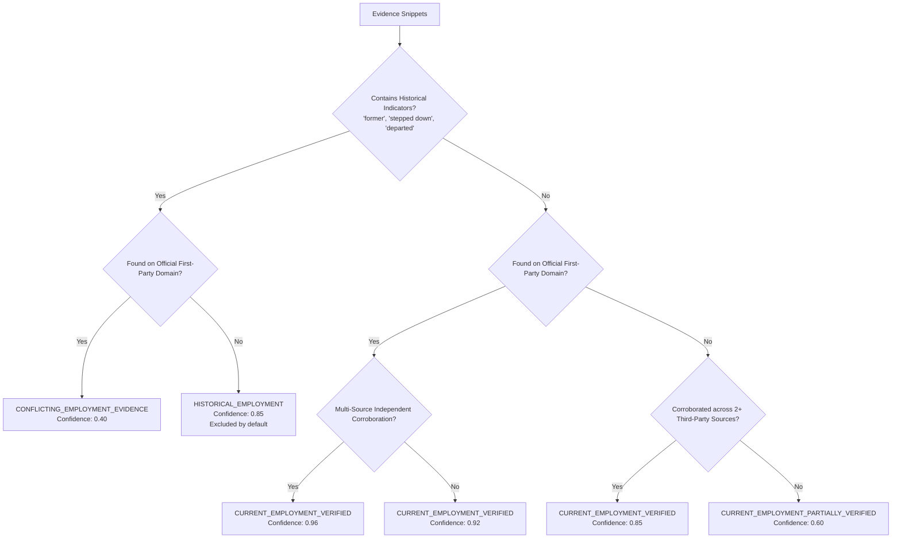

# Outmate GTM — Decision Maker Discovery & Verification Architecture

## 1. Overview & Mission

The **Outmate GTM Decision Maker Discovery & Verification Engine** identifies real people holding commercial decision-making and purchasing influence within target companies.

### Foundational Principles
- **Strict Evidence Grounding**: Zero synthetic personas, fake directories, or AI hallucinations. Every candidate must originate from publicly retrieved sources.
- **Current Employment Corroboration**: Explicitly distinguishes between active and historical employees using first-party pages and departure announcements.
- **Authority vs. Job Title Disambiguation**: Differentiates nominal seniority from actual purchasing influence (e.g., Economic Buyer vs. Technical Decision Maker vs. Evaluator).
- **Audit-Ready Evidence Provenance**: Every person, role, and assessment maintains direct links to granular `EvidenceRecord` items with source URLs and captured text snippets.
- **Privacy & Compliance**: Relies exclusively on public sources; never engages in unauthorized LinkedIn scraping, login-wall bypasses, or email pattern guessing.

---

## 2. Taxonomy & Classifications

### A. Seniority Levels (`SeniorityLevel`)
- `c_level`: Chief Executive Officer, Chief Technology Officer, Chief Operating Officer, Chief Financial Officer, etc.
- `vp`: Vice President, Senior Vice President, Executive Vice President.
- `head`: Head of Engineering, Head of Product, Head of Security, etc.
- `director`: Director of Engineering, Senior Director of Sourcing, etc.
- `manager`: Engineering Manager, Product Operations Manager, Team Lead.
- `ic`: Staff Engineer, Principal Architect, Senior Developer, Account Executive.
- `unknown`: Seniority ambiguous from public excerpts.

### B. Functional Departments (`Department`)
- `executive`: Corporate governance and executive leadership.
- `engineering`: Software engineering, infrastructure, cloud, DevOps, SRE, architecture.
- `security`: Information security, cybersecurity, compliance, risk.
- `product`: Product management, design, UX.
- `sales`: Enterprise sales, revenue, business development, partnerships.
- `marketing`: Growth marketing, brand, communications.
- `finance`: Financial management, accounting, treasury, investor relations.
- `operations`: Business operations, supply chain, procurement, sourcing.
- `human_resources`: Talent acquisition, people operations.
- `legal`: General counsel, legal affairs, compliance.
- `other`: Uncategorized.

### C. Buying Persona & Influence Categories (`DecisionInfluenceCategory`)
| Category | Definition | Typical Roles |
|---|---|---|
| `economic_buyer` | Holds corporate budget ownership and ultimate purchasing authority. | CEO, CFO, President |
| `technical_decision_maker` | Owns technical architecture and veto power over developer/cloud tools. | CTO, VP Engineering, CISO |
| `business_decision_maker` | Directs commercial initiatives and purchases department-specific software. | VP Product, CRO, COO |
| `procurement_stakeholder` | Manages commercial vendor reviews, contract terms, and purchasing policies. | Director of Procurement, Sourcing Lead |
| `influencer` | Respected technical leader whose recommendations sway platform choices. | Principal Architect, Staff Engineer |
| `evaluator` | Hands-on practitioner evaluating daily developer experience and usability. | Senior Software Engineer, Team Lead |

---

## 3. Employment Verification Engine

The `EmploymentVerificationService` evaluates retrieved evidence against deterministic rules:

### Identity Disambiguation (`PersonIdentityResolutionService`)
- Normalizes names by stripping honorifics (`Dr.`, `Prof.`, `Mr.`) and credential post-nominals (`Ph.D.`, `MBA`, `Esq.`).
- When two records share an identical name at the same company:
  - If titles are compatible (e.g. `CEO` and `CEO and Founder`), evidence records and profile URLs are merged into a single enriched prospect.
  - If titles are incompatible (e.g. `Staff Software Engineer` vs. `VP Global Sales`), both candidates are preserved under `EmploymentStatus.IDENTITY_AMBIGUOUS` to prevent destructive overwriting.

---

## 4. Multi-Dimensional Relevance Scoring

The `ScoringService` calculates a calibrated 0–100 relevance score:

$$\text{Overall Score} = (\text{Seniority Fit} \times 35) + (\text{Department Fit} \times 35) + (\text{Evidence Confidence} \times 30)$$

- **Seniority Fit**: Evaluated against target seniority criteria or standard organizational hierarchy.
- **Department Fit**: Evaluated against target department criteria and product scenario keyword alignment.
- **Evidence Confidence**: Grounded in corroboration status:
  - `CURRENT_EMPLOYMENT_VERIFIED`: Full credit ($1.0 \times \text{base}$).
  - `CURRENT_EMPLOYMENT_PARTIALLY_VERIFIED`: Discounted ($0.8 \times \text{base}$).
  - `HISTORICAL_EMPLOYMENT`: Heavily penalized ($0.15$), preventing former employees from ranking in High/Medium tiers.
- **Relevance Tiers**:
  - **High** ($\ge 75$): Primary decision-maker candidate for immediate outreach.
  - **Medium** ($\ge 50$): Strong stakeholder with departmental purchasing influence.
  - **Low** ($\ge 25$): Peripheral or junior stakeholder.
  - **Irrelevant** ($< 25$): Insufficient evidence or former employee.

---

## 5. Future MCP Tool Contracts (Phase 4 Preparation)

All service boundaries in `PeopleResearchService` are decoupled from HTTP request/response objects to enable direct reuse in Claude.ai MCP servers:

| MCP Tool Name | Description | Key Arguments |
|---|---|---|
| `find_decision_makers` | Discovers and ranks decision-makers at a target company. | `company_name`, `company_domain`, `target_departments`, `limit` |
| `verify_person` | Verifies current employment and influence for an individual. | `person_name`, `company_name`, `company_domain` |
| `get_person_details` | Retrieves background, contact coordinates, and evidence. | `full_name`, `company_name`, `linkedin_url` |
| `get_decision_maker_sources` | Retrieves public evidence backing a discovery run. | `research_id` |

