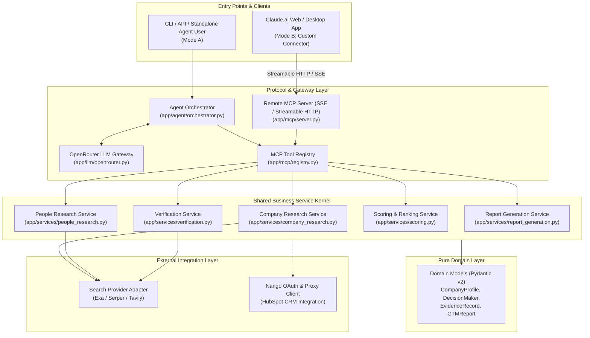
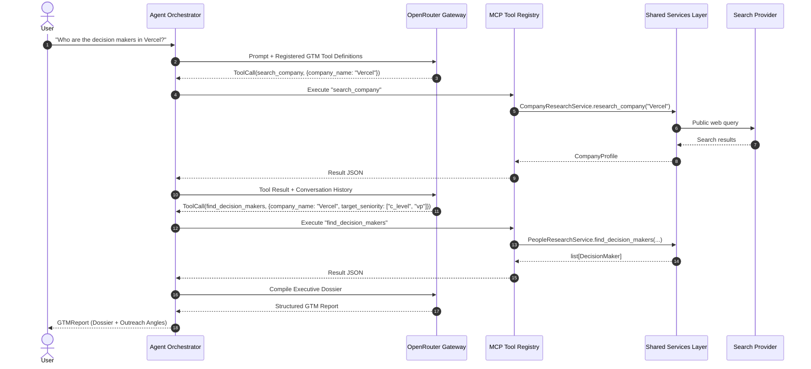
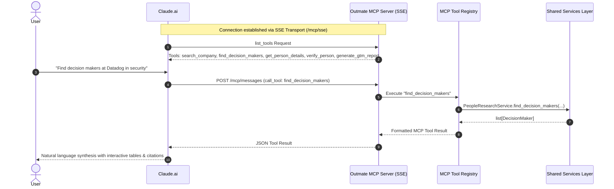

# Outmate GTM — System Architecture

## 1. Executive Architectural Overview

Outmate GTM is an enterprise-grade AI research engine that automates company intelligence research and discovers verified business decision-makers from natural-language queries.

The platform provides a unified service kernel serving two independent execution modes:
- **Mode A (Standalone Python AI Agent)**: An autonomous CLI and background agent orchestrator communicating with LLMs via OpenRouter using OpenAI-compatible function calling.
- **Mode B (Claude.ai Custom Connector)**: A remotely deployed Model Context Protocol (MCP) server providing Streamable HTTP/SSE endpoints that Claude.ai connects to directly.

---

## 2. High-Level Architecture Diagram

---

## 3. Execution Mode A: Standalone Python AI Agent (OpenRouter)

In Mode A, Outmate operates autonomously without Claude.ai:
1. User provides a query via CLI or API (e.g. *"Who are the decision makers in Vercel?"*).
2. The `ResearchPlanner` analyzes the query and extracts targeting constraints.
3. The `AgentOrchestrator` invokes `OpenRouterClient` (using model configured in `OPENROUTER_MODEL`, e.g. `anthropic/claude-3.5-sonnet` or `openai/gpt-4o`).
4. The model returns tool calls corresponding to registered GTM tools (`search_company`, `find_decision_makers`, `get_person_details`, `verify_person`, `generate_gtm_report`).
5. Tool calls execute against shared services, returning structured JSON back into the agent conversation loop.
6. The agent terminates by generating a complete `GTMReport`.

---

## 4. Execution Mode B: Claude.ai Custom Connector (Remote MCP Server)

In Mode B, Claude.ai acts as the host and orchestration engine:
1. Outmate GTM is deployed to an HTTPS host (e.g., `https://api.outmate.ai/mcp/sse`).
2. The user connects Claude.ai to this URL using Claude's Custom Connector settings.
3. Claude.ai connects via Server-Sent Events (SSE) and receives the list of available tools (`list_tools`).
4. When the user asks Claude.ai a question in chat, Claude chooses when to call Outmate's GTM tools via POST requests to the MCP endpoint.
5. `OutmateMCPServer` validates the input schema, checks Bearer authorization (if configured), and executes the exact same shared service kernel.
6. Structured tool results are rendered directly inside Claude.ai's conversational interface.

---

## 5. Architectural Invariants

1. **Service Reuse**: Every business function (company lookup, executive identification, verification, relevance ranking, report formatting) is implemented once in `app/services/` and consumed by both modes.
2. **Protocol Independence**: The services layer has zero dependency on FastAPI, Starlette, OpenAI SDK, or MCP SDK types.
3. **Strict Nango Boundaries**: Nango manages third-party OAuth tokens and executes authorized proxies (e.g. HubSpot CRM). It never manages LLM execution or internal agent states.
4. **Data Integrity**: All discovered entities must link back to public `EvidenceRecord` instances with confidence metrics.

