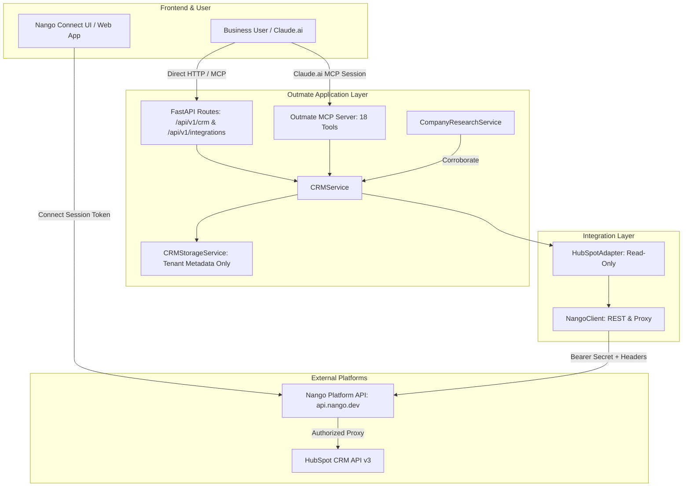

# Phase 5 Architecture Overview — Nango Integration & CRM Intelligence Layer

**System:** Outmate GTM Platform  
**Phase:** 5 (External Application Integration Layer)  
**Status:** Production Ready  

---

## 1. Architectural Philosophy

Outmate GTM's primary mission is to identify, profile, and verify B2B target accounts and executive decision-makers using evidence-backed AI research. Phase 5 bridges Outmate GTM with enterprise customer relationship management (CRM) software—specifically HubSpot CRM—via **Nango**.

The architecture adheres to three core design pillars:
1. **Strictly Decoupled Identity & Token Management:** Outmate GTM never stores, handles, or requests raw OAuth 2.0 access or refresh tokens. Nango acts as an isolated third-party connection and proxy gateway.
2. **Strictly Read-Only Access:** The CRM integration is incapable of mutating customer data. Writes, updates, deletes, and sales communications are strictly blocked at multiple architectural layers.
3. **Dual-Track Evidence Corroboration:** Public web findings and internal CRM records maintain distinct provenance trails. Internal records corroborate public research rather than silently replacing it.

---

## 2. Component Hierarchy & Data Flow

---

## 3. Subsystem Breakdown

### 3.1 Nango Integration Layer (`app/integrations/nango/`)
- `NangoClient`: High-performance asynchronous HTTP client handling:
  - Ephemeral Connect Session creation (`POST /connect/sessions`)
  - Connection lifecycle checks (`GET /connection/{connection_id}`)
  - Connection revocation (`DELETE /connection/{connection_id}`)
  - Transparent authenticated proxying (`GET/POST /proxy/{endpoint}`) with automatic retries and exponential backoff
- `NangoConfig` & `NangoConnectionIdentity`: Strict configuration models enforcing server-side secret key protection.
- `errors.py`: Fine-grained exception hierarchy translating HTTP status codes into typed domain errors (`NangoAuthError`, `NangoConnectionNotFoundError`, `NangoExpiredConnectionError`, `NangoRateLimitError`, `NangoProxyError`).

### 3.2 HubSpot Provider Adapter (`app/integrations/providers/hubspot/`)
- `HubSpotAdapter`: Domain-specific client translating Outmate business queries into HubSpot CRM v3 API endpoints:
  - Companies: `/crm/v3/objects/companies` and `/crm/v3/objects/companies/search`
  - Contacts: `/crm/v3/objects/contacts` and `/crm/v3/objects/contacts/search`
  - Deals: `/crm/v3/objects/deals`
  - Associations: `/crm/v3/objects/{fromType}/{id}/associations/{toType}`
- `normalizers.py`: Safe JSON deserializers mapping raw HubSpot payloads into `CRMCompany`, `CRMContact`, and `CRMDeal` domain models while handling nulls, non-numeric strings, and preserving raw properties.
- `capabilities.py`: Enforces requested scopes (`crm.objects.companies.read`, `crm.objects.contacts.read`, `crm.objects.deals.read`).

### 3.3 Application CRM Service & Storage (`app/services/`)
- `CRMService`: Enterprise service orchestrating:
  - Tenant connection resolution (`resolve_connection_id`)
  - Tenant ownership verification (`validate_tenant_ownership`)
  - Structured audit logging (`_log_audit`)
  - Research evidence corroboration (`corroborate_research_with_crm`)
- `CRMStorageService`: Metadata-only registry persisting connection statuses, verification timestamps, and tenant IDs. Never touches access tokens.

### 3.4 MCP Server Tools Layer (`app/mcp/tools/crm_tools.py`)
- Exposes 9 read-only CRM tools to Claude.ai and AI agents.
- Enforces OAuth scopes (`integrations:read`, `crm:companies:read`, `crm:contacts:read`, `crm:deals:read`).
- Sanitizes all external CRM text strings (`sanitize_crm_content`) and injects security delimiters (`wrap_untrusted_crm_payload`) to mitigate prompt injection.

