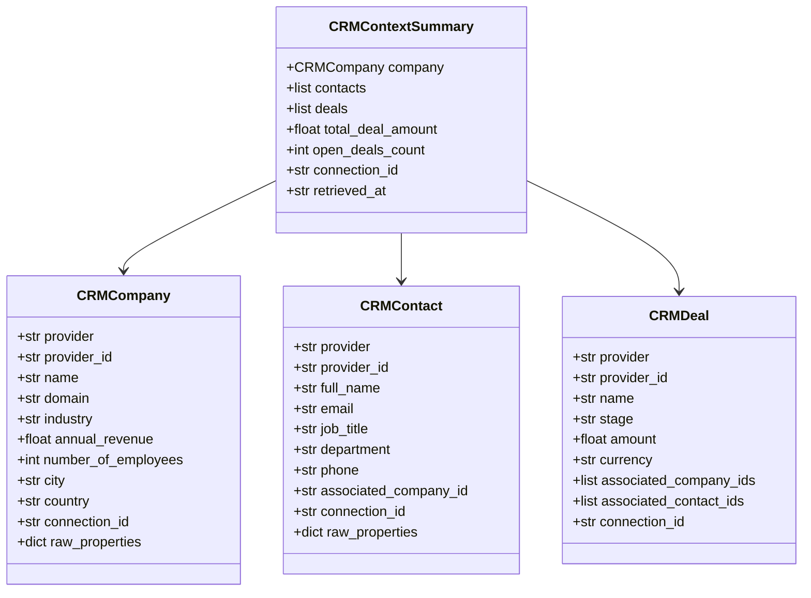

# CRM Normalized Domain Models — Outmate GTM

**Module:** `app.domain.models.crm`  
**Purpose:** Formal specifications for normalized CRM records, relationships, and context envelopes.

---

## 1. Domain Model Hierarchy

All CRM domain models inherit from Pydantic `BaseModel` and include:
- Provider attribution (`provider="hubspot"`)
- Primary provider ID (`provider_id`)
- Tenant ownership reference (`connection_id`)
- Safe property normalization
- Complete preservation of raw payload properties in `raw_properties`

---

## 2. Model Specifications

### 2.1 `CRMCompany`
Represents an organization or target corporate account.

| Field | Type | Description |
| :--- | :--- | :--- |
| `provider` | `str` | CRM provider (default: `"hubspot"`) |
| `provider_id` | `str` | Provider internal object ID |
| `name` | `str` | Company business name |
| `domain` | `str \| None` | Normalized lowercase domain (e.g. `"vercel.com"`) |
| `industry` | `str \| None` | Industry sector classification |
| `annual_revenue` | `float \| None` | Reported annual revenue (parsed safely) |
| `number_of_employees` | `int \| None` | Headcount figure |
| `city` | `str \| None` | City location |
| `country` | `str \| None` | Country location |
| `connection_id` | `str` | Outmate tenant connection owning this record |
| `raw_properties` | `dict[str, Any]` | Complete original provider property dictionary |

### 2.2 `CRMContact`
Represents an individual contact, executive, or decision-maker.

| Field | Type | Description |
| :--- | :--- | :--- |
| `provider` | `str` | CRM provider (default: `"hubspot"`) |
| `provider_id` | `str` | Provider internal contact ID |
| `full_name` | `str` | Normalized full name (computed from first/last or email) |
| `email` | `str \| None` | Primary email (normalized to lowercase) |
| `job_title` | `str \| None` | Business role or title |
| `department` | `str \| None` | Department name if recorded |
| `associated_company_id` | `str \| None` | Linked company ID in CRM |
| `connection_id` | `str` | Outmate tenant connection owning this record |

### 2.3 `CRMDeal`
Represents an active or historic sales opportunity.

| Field | Type | Description |
| :--- | :--- | :--- |
| `provider_id` | `str` | Provider internal deal ID |
| `name` | `str` | Deal / opportunity title |
| `stage` | `str` | Pipeline stage identifier |
| `amount` | `float \| None` | Monetary value |
| `currency` | `str` | Currency code (default: `"USD"`) |
| `associated_company_ids`| `list[str]` | IDs of linked companies |
| `associated_contact_ids`| `list[str]` | IDs of linked contacts |

### 2.4 `CRMContextSummary`
Aggregated account intelligence snapshot combining the company, associated decision-makers, and pipeline deals.

